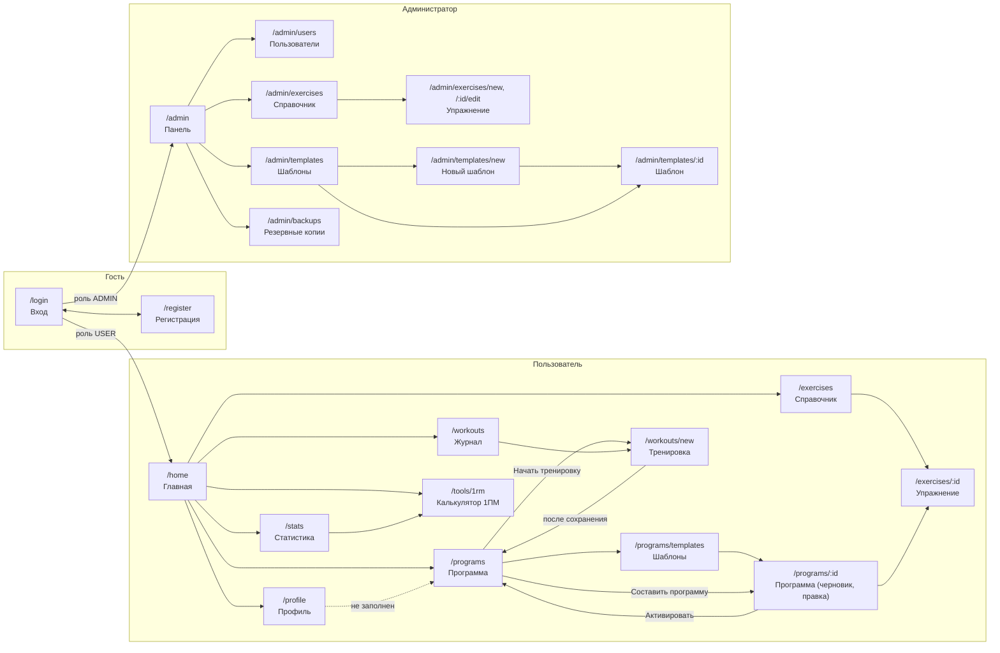

# Схема навигации (раздел 4.2.5)

Меню в шапке зависит от роли из сессии. На ширине больше 1100 px меню показывается в строку, на 1100 px и меньше открывается кнопкой-бургером. Логотип «Тренировочный дневник» ведёт на стартовую страницу роли: `/home` у пользователя, `/admin` у администратора, `/login` у гостя.

## Меню по ролям

| Роль | Пункты меню (по порядку) |
|---|---|
| Гость | Вход, Регистрация |
| Пользователь | Программа, Тренировка, Журнал, Статистика, Упражнения, 1ПМ, Профиль, *логин* (только в меню-бургере), Выйти |
| Администратор | Панель, Пользователи, Упражнения, Шаблоны, Резервные копии, Выйти |

## Служебные страницы

- `403` — страница недоступна роли (например, пользователь открыл `/admin`).
- `404` — адрес не найден, упражнение, программа или тренировка не найдены либо принадлежат другому пользователю.
- `error` — запрос не выполнен (400, 409, 413, 500) с сообщением на русском языке.

Скриншоты всех страниц на 1440 / 820 / 375 px лежат в `docs/screenshots/` (имя файла: `<страница>-<ширина>.png`).
